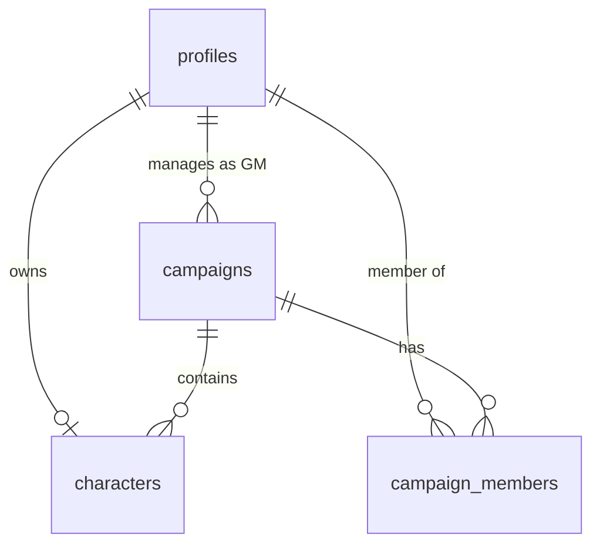

# BattleTech RPG Helper

[](https://opensource.org/licenses/MIT)
[](https://nextjs.org)
[](https://developer.mozilla.org/en-US/docs/Web/Progressive_web_apps)

**BattleTech RPG Helper** is a modern, mobile-friendly web port and rewrite of the original C++/Qt desktop [BattleTech Character Creator](https://github.com/bearchik/Battletech-Character-Creator). It is designed to assist players and Game Masters (GMs) of the *Classic BattleTech: A Time of War* RPG by providing seamless character creation, cloud syncing, and real-time campaign management.

The project is structured as an installable Progressive Web App (PWA) that bridges the gap between offline desktop tools and cloud-enabled collaborative play.

---

## 🌟 Key Features

- **☁️ Cloud Sync & Data Consistency**: No more loose files. Characters live in a secure cloud database and are instantly accessible on any device.
- **👁️ Game Master (GM) Oversight**: Create or join campaigns. GMs have full visibility and live editing capabilities for all player characters in their campaigns.
- **📱 Installable PWA (Mobile-First)**: Built to work beautifully on mobile viewports at the gaming table, with offline support powered by Serwist.
- **🔄 `.btcc` Native Import/Export**: Fully compatible with the desktop app. Supports importing existing `.btcc` character sheets and exporting them with 100% byte-compatibility.
- **⚡ Real-Time Syncing**: Real-time collaborative editing. GMs can edit character sheets, and players see updates immediately, and vice-versa.
- **🛡️ Manual Mech Damage**: Track armor, internal structure, critical hits, heat and pilot hits in view mode with batch Apply and conflict protection. See the [mech damage guide](docs/MECH_DAMAGE.md) for reset and replacement behavior.

---

## 🛠️ Technology Stack

- **Frontend Framework**: [Next.js](https://nextjs.org/) (App Router, React, TypeScript)
- **Styling**: [Tailwind CSS](https://tailwindcss.com/)
- **Backend & Database**: [Supabase](https://supabase.com/) (PostgreSQL, GoTrue Auth, Realtime, Row-Level Security)
- **State Management & Forms**: `react-hook-form` + `zod`
- **Offline / PWA**: `@serwist/next` (Service Workers)
- **Testing**: [Vitest](https://vitest.dev/) (Unit / Integration) & [Playwright](https://playwright.dev/) (E2E)

---

## 🗄️ Database Architecture

To ensure strict data security and compliance with GM/Player relationships, authorization is enforced entirely at the database layer via Supabase **Row-Level Security (RLS)**.



### Table Schema Highlights

1. **`profiles`**: User metadata synchronized with auth accounts.
2. **`campaigns`**: Campaign records with a unique invite code.
3. **`campaign_members`**: Link table defining roles (`gm`, `player`) within campaigns.
4. **`characters`**: Character sheets stored with JSONB documents for attributes, skills, and traits to maintain exact ordering for desktop compatibility.

*For detailed specifications, see the database design and RLS policy rules in the [PLAN.md](file:///home/orin/Work/Personal/battletech-rpg-helper/docs/PLAN.md).*

---

## 🔄 `.btcc` Compatibility

One of the project's primary goals is **byte-compatible round-trip fidelity** with the C++/Qt desktop app.
- **Importing**: Parsed entirely client-side. The file is validated against the catalog rules, translating attributes, traits, and skills into application state.
- **Exporting**: Regenerates the `.btcc` format using desktop key order, formatting, and notes.

### Attribute display

Saved character sheets and import previews show attribute **Level** (`floor(XP / 100)`) and signed **Link Modifier**, including `+0`, instead of raw attribute XP. Edit mode retains accumulated XP inputs (`100 XP per level`); derived values never replace stored XP or alter `.btcc` serialization.

Missing attribute XP displays `N/A` for both values. Zero and negative levels remain visible, with Link Modifier `N/A` below Level 1. The modifier is −2 at Level 1, −1 at Levels 2–3, +0 at 4–6, +1 at 7–9, +2 at 10, and `floor(level / 3)` at 11 and above.

### Trait display

Edit mode shows live attained Trait Points beside each trait's raw XP input: positive TP in green, negative TP in red, and `0 TP` in muted text. The saved sheet additionally labels zero TP as `Inactive`. Indicators recalculate when names or XP change and when traits are added or removed, including cancellation between explicit opponents. Inputs and saves retain exact signed XP; displayed TP never replaces stored XP or changes `.btcc` serialization.

### Equipment and weapon catalogs

`lib/rules/load.ts` statically bundles the Warrior's Catalog, with canonical/legacy-name lookup (`findEquipment`, `findWeapon`), exact-ID lookup, and category/weapon-skill filters. Costs and masses are normalized only when unambiguous; multipliers, conditional expressions, original cells, scoped notes, and source page references remain available. This is inventory data, not a combat rules evaluator.

Generate `data/rules/equipment.json` and `weapons.json` with `npm run equipment:ingest`. It reads the 50 transcribed tables in `docs/rule_book/Warriors-Catalog/` and the curated `docs/rule_book/equipment-mapping.json`; no desktop checkout or environment variable is needed. Add new tables/layouts and reviewed aliases to the manifest; stale selectors, unmapped collisions, or changed explicit duplicates fail generation before replacing either artifact. Never edit generated catalogs directly.

`docs/rule_book/mech_weapons.json` was downloaded from Solaris Skunk Werks' [`Data/Equipment/weapons.json`](https://github.com/Solaris-Skunk-Werks/solarisskunkwerks/blob/master/Data/Equipment/weapons.json).

Each ingestion invocation reads the current generated `data/rules/skills.json` for weapon-skill validation; aggregate ingestion regenerates skills first. The pure `buildEquipmentCatalog(tables, mapping, skillNames)` API takes its canonical skill names explicitly, so repeated builds cannot reuse a stale module-level skill snapshot.

Consumers import `lib/btcc/inventory` directly for lossless 7/11-field views and new equipment, weapon, or physical-ammunition rows. Creators return typed failures for unresolved amounts/coverage, invalid values, or desktop-unsafe delimiters. Purchase cost/mass are stack totals; shots and reload values remain per unit. Monetary values/counts must fit desktop signed-32-bit integer arithmetic; fractional catalog prices require an explicit integer price override, never silent rounding. Pure-PPS weapons require a separately selected power pack.

Book and desktop defaults can differ: the Clan pulse laser pistol's book reload cells are `†` (unresolved), while the desktop fixture stores reload purchase values `5`/`0.25`. Preserve both representations in their respective paths; the imported Power Pack's trailing `2`/`0.14` fields are separate legacy ammo metadata, not its purchase price/mass.

Imported inventory remains raw and byte-preserving, including unknown/custom names, malformed positional rows, historical ammo metadata, and Marian Suit coverage. Alias resolution identifies a catalog entry; it never replaces imported statistics. New notes include labeled table/shared context, flatten whitespace, and replace colon/semicolon delimiters; source notes and imported rows stay verbatim.

### Inventory and combat loadout

The character editor has **Sheet**, **Equipment**, and **Mech** tabs. Equipment lists Weapons, Armor, and Other Gear with stored details and carried-mass/inventory-value totals. Unknown amounts produce partial totals, not zero-valued assumptions. Stack cost and mass already include quantity; reload columns are not added again.

In Edit mode, search the bundled equipment/weapon catalogs and stage a separate stack. Resolve any requested manual amounts or armor ratings, then choose **Add item**. Quantity text commits only with **Apply quantity**. Additions never debit C-Bills or automatically ready/wear an item. Modifiers are not standalone purchases. Owners and campaign GMs use the same version-checked Save, Cancel, and conflict workflow; switching tabs retains the draft.

Ready up to three weapon copies, subject to known owned quantity. Armor placement uses stored coverage, previews displaced garments, and takes off the entire displaced garment. **Unready** removes one ordered ready entry; **Take off** removes all placements of that garment. Imported excess, missing names, duplicate-name ambiguity, unknown slots, and unsupported rows remain visible and repairable rather than silently normalized. Removing the last parsed exact-name inventory row clears its references; remaining same-name stacks keep them.

The Sheet's read-only **Combat loadout** shows only readied weapons and worn armor, including in local-file import previews. Duplicate-name references display variants instead of guessed stats; armor BAR stays per garment, never summed across layers. Quantity changes preserve unrelated stored fields and notes. Unsupported rows can be inspected and explicitly removed but cannot have their quantities recalculated.

---

## 🚀 Getting Started

### Prerequisites

- Node.js (v18.x or later)
- npm
- A Supabase project instance

### Installation

1. **Clone the repository**:
   ```bash
   git clone https://github.com/your-username/battletech-rpg-helper.git
   cd battletech-rpg-helper
   ```

2. **Install dependencies**:
   ```bash
   npm install
   ```

3. **Set up local environment variables**:
   From the repository root, copy the template to `.env.local`. If `.env.local` already exists, edit its values instead of overwriting it.

   Bash:
   ```bash
   cp .env.example .env.local
   ```

   Windows PowerShell:
   ```powershell
   Copy-Item .env.example .env.local
   ```

   Fill in `BT_CHARGEN_SUPABASE_URL` with your Supabase project's URL and `NEXT_PUBLIC_BT_CHARGEN_SUPABASE_ANON_KEY` with the public anon key from that same project.

   `next.config.ts` exposes the non-secret `BT_CHARGEN_SUPABASE_URL` to the browser at build time despite its lack of a `NEXT_PUBLIC_` prefix. The anon key is also public by design; Row Level Security (RLS) protects data. After changing these values, restart the development server and rebuild deployed bundles.

   `BT_CHARGEN_SUPABASE_SERVICE_ROLE_KEY` is an optional server-only secret. Ordinary app development does not require it; leave it blank. Never prefix it with `NEXT_PUBLIC_` or add it to Next's `env` mapping.

4. **Ingest Rules Data**:
   Convert the raw game tables into static typed JSON:
   ```bash
   npm run rules:ingest
   ```

   Aggregate ingestion also runs the rulebook equipment parser. Desktop-backed inputs still expect `BTCC_SOURCE_DIR` to name the **resource directory**, for example:
   ```bash
   BTCC_SOURCE_DIR=/home/orin/Work/Personal/Battletech-Character-Creator/resource npm run rules:ingest
   ```

5. **Start the development server**:
   ```bash
   npm run dev
   ```

---

## Password recovery deployment

In the hosted Supabase project's **Authentication → URL Configuration**, set
**Site URL** to the production HTTPS origin. Add the full recovery callback to
**Redirect URLs** for each domain where users can request a reset:

```text
https://battletech-rpg-helper.vercel.app/auth/callback?next=/reset-password
```

Vercel preview domains need their own allowed callbacks if recovery is tested
there. The repository's `supabase/config.toml` configures the local stack only;
deploying the app does not update hosted Auth settings.

The Supabase **Reset Password** email template should link to
`{{ .ConfirmationURL }}` so verification preserves the requested callback.
Request a fresh email after changing settings, and open it in the browser that
requested the reset: the PKCE verifier is stored in that browser's cookies.

The homepage also forwards a returned `?code=…` to `/auth/callback` when Supabase
falls back to the Site URL. The callback exchanges the code before opening
`/reset-password`; missing, expired, or unverifiable codes return to login with
an invalid-link error.

## 🧪 Testing

The test suite runs using Vitest for logic checks and Playwright for cross-device verification.

- **Run unit tests** (including the `.btcc` serialization golden test):
  ```bash
  npm run test
  ```
- **Run end-to-end tests**:
  ```bash
  npm run test:e2e
  ```

---

## 🤝 Contributing

We welcome contributions from the BattleTech community! Please read our [Contribution Guidelines](CONTRIBUTING.md) and check out our [Development Roadmap](file:///home/orin/Work/Personal/battletech-rpg-helper/docs/PLAN.md) before starting.

1. Fork the Project.
2. Create your Feature Branch (`git checkout -b feature/AmazingFeature`).
3. Commit your Changes (`git commit -m 'Add some AmazingFeature'`).
4. Push to the Branch (`git push origin feature/AmazingFeature`).
5. Open a Pull Request.

---

## 📄 License

Distributed under the MIT License. See `LICENSE` for more information.
